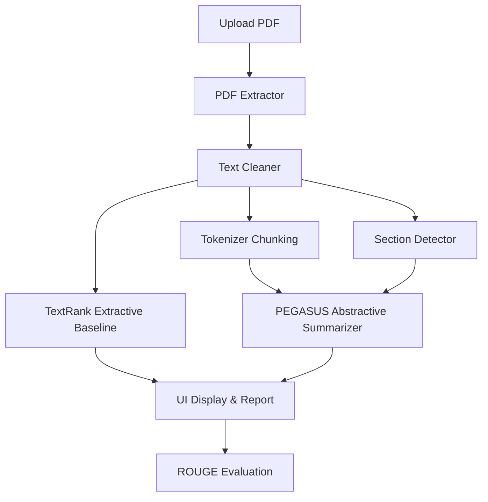

# 📄 Scientific Research Paper Summarizer

A powerful web application designed specifically for academic and scientific research paper summarization. It combines the strengths of extractive summarization (TextRank) and abstractive summarization (PEGASUS) to provide comprehensive document analysis.

## 🎯 Problem Statement & Motivation

Scientific papers are often lengthy and dense, making it difficult to quickly extract the core methodology, results, and conclusions. This tool bridges that gap by offering:
- **Baseline Extractive Summary**: Using TextRank to highlight the most critical sentences directly from the text.
- **Proposed Abstractive Summary**: Using the state-of-the-art PEGASUS model fine-tuned on scientific datasets (arXiv / PubMed) to generate human-like abstracts.
- **Section-wise Analysis**: Heuristic extraction and summarization of key sections (Abstract, Introduction, Methodology, Results, Conclusion).

*Note: PEGASUS is used as a pretrained/fine-tuned scientific summarization model from Hugging Face. We do not claim to have trained it from scratch.*

## ✨ Features

- 📤 **Upload Research Papers** (PDF format)
- 🔍 **Smart Text Extraction** (PyMuPDF with Tesseract OCR fallback)
- 🧩 **Long-Document Chunking** (Tokenizer-aware chunking to handle papers that exceed model limits)
- 🧠 **PEGASUS Abstractive Summarization** (`google/pegasus-arxiv` or `google/pegasus-pubmed`)
- 📊 **TextRank Extractive Baseline** (Sentence-scoring baseline via `sumy`)
- 📑 **Scientific Section Detection** (Heuristic detection of common academic headings)
- 📈 **Reference-based Evaluation** (Calculate ROUGE-1, ROUGE-2, ROUGE-L against user-provided reference summaries)
- 📥 **Download Comprehensive Analysis Reports**

## 🏗️ Architecture



## 🚀 Setup Instructions

1. **Clone the repo:**
   ```bash
   git clone https://github.com/MananVyas01/ai-pdf-summarizer.git
   cd ai-pdf-summarizer
   ```

2. **Create virtual environment & activate it (optional but recommended):**
   ```bash
   python -m venv .venv
   # Windows
   .venv\Scripts\activate
   # Linux/Mac
   source .venv/bin/activate
   ```

3. **Install dependencies:**
   ```bash
   pip install -r requirements.txt
   ```

4. **Install Tesseract OCR (for scanned PDF support):**
   - **Windows:** Download from [GitHub Releases](https://github.com/tesseract-ocr/tesseract/releases) and add to PATH.
   - **Linux:** `sudo apt-get install tesseract-ocr poppler-utils`
   - **macOS:** `brew install tesseract poppler`

5. **Run the application:**
   ```bash
   streamlit run app.py
   ```

## 📚 How to Use

1. **Configure Model**: Open the sidebar and select the PEGASUS model (arXiv or PubMed).
2. **Upload PDF**: Upload a scientific paper.
3. **Generate Summaries**: Click "Generate Summaries". The app will chunk the text, run TextRank, and run PEGASUS.
4. **Evaluate (Optional)**: Paste the original abstract into the Evaluation text area and click "Calculate ROUGE".
5. **Download Report**: Click "Download Analysis Report" to get a `.txt` file containing the summaries and evaluation metrics.

## 🎯 Project Structure

```text
scientific-paper-summarizer/
├── app.py                 # Main Streamlit application
├── api.py                 # FastAPI endpoints
├── requirements.txt       # Project dependencies
├── README.md              # Project documentation
├── utils/                 # Modular utilities
│   ├── pdf_extractor.py   # PyMuPDF and OCR text extraction
│   ├── text_cleaner.py    # Text formatting and cleaning
│   ├── section_detector.py# Heuristic section detection
│   ├── text_chunker.py    # Tokenizer-aware chunking for LLMs
│   ├── textrank.py        # Extractive baseline summarization
│   ├── pegasus.py         # Abstractive summarization logic
│   └── evaluation.py      # ROUGE metrics calculation
```

## 📊 Evaluation Methodology

This project utilizes the Hugging Face `evaluate` library to compute ROUGE scores. Since generating intrinsic evaluations without a reference is flawed, we explicitly require a **reference summary** (e.g., the paper's original abstract) to compute ROUGE-1, ROUGE-2, and ROUGE-L.

## ⚠️ Limitations

- Section detection relies on common heading heuristics and may not perfectly detect sections in unconventionally formatted papers.
- Very long PDFs (e.g., full books) might take a significant amount of time to summarize due to sequential chunk processing.
- The OCR fallback depends on Tesseract accuracy, which drops significantly on low-quality scans.

## 🌱 Future Improvements

- Add batch processing support for full dataset evaluation (e.g., sampling 50 arXiv papers and aggregating ROUGE scores automatically).
- Support open-source smaller models natively integrated with GPU acceleration for local inference.
- Finer-grained chunk overlap to prevent context loss at chunk boundaries.

---

<div align="center">
  <p>🚀 <strong>Scientific Research Paper Summarizer</strong> | Built with ❤️ using Streamlit</p>
  <p>📧 Questions or feedback? Reach out to <strong>Manan Vyas</strong></p>
</div>
